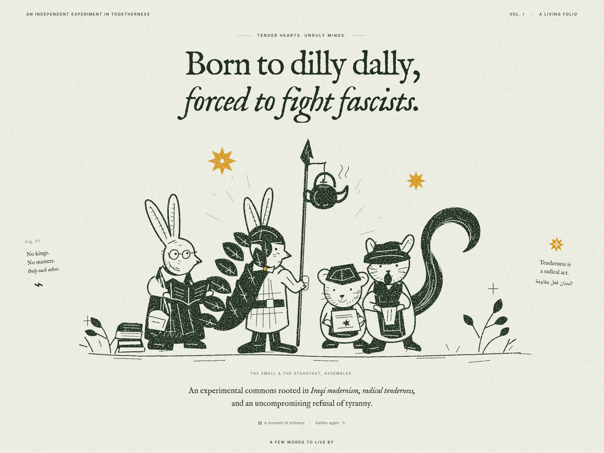

# BKF Radical Folio — Landing Page

> *"Born to dilly dally, forced to fight fascists."*  
> — Tender Hearts. Unruly Minds.



An illustrated anti-fascist literary landing page sharing BKF's radical reading canon, key texts, and ideas through tactile broadsheet-inspired design.

Rooted in **Iraqi modernism**, **radical tenderness** (*الحنان فعل مقاومة*), and an uncompromising refusal of tyranny.

---

## ✦ Table of Contents

- [The Story & Ethos](#the-story--ethos)
- [Design Identity & Broadsheet Aesthetics](#design-identity--broadsheet-aesthetics)
- [Key Features](#key-features)
- [Typography & Color Palette](#typography--color-palette)
- [Reading Canon](#reading-canon)
- [Project Structure](#project-structure)
- [Local Development](#local-development)
- [Deployment](#deployment)
- [License](#license)

---

## The Story & Ethos

The **BKF Radical Folio** is an independent experiment in togetherness, published as an homage to the clandestine anti-fascist broadsheet presses, the teahouses (*chaikhanas*) of Baghdad, and the radical modernism of the 1951 Baghdad Modern Art Group (*جماعة بغداد للفن الحديث*).

### The Four Animal Comrades
Featured in the central linocut tableau:
1. **The Scholar Rabbit:** Poring over open books with wire spectacles and stacked texts at its feet.
2. **The Knight Rabbit:** Draped in a leaf-mantle with a golden star clasp, bearing a spear hoisted with a steaming samovar kettle.
3. **The Field Mouse:** Sporting a peaked garrison cap, safeguarding the radical star manifesto.
4. **The Sentry Squirrel:** Newsboy cap, grand curled tail, delivering broadsheets to the street.

---

## Design Identity & Broadsheet Aesthetics

The visual language reproduces the tactile warmth of a mid-century literary broadsheet:
- **Paper Tone:** `#F6F4EE` (unbleached newsprint cotton ground).
- **Ink:** `#1C2520` (organic dark forest-black ink).
- **Accent:** `#D4972D` (8-pointed Ishtar star / Mesopotamian octagram amber).
- **Marginalia:** Classical 3-column broadside grid with marginal notes, figures, and bilingual English/Arabic calligraphy.

---

## Key Features

- **Interactive Ambient Stillness:** Pure Web Audio API synthesized chord tone simulating teahouse warmth and harmonic calmness (`A moment of stillness`).
- **Aphorism Rotator:** Cycles through the living folio's core mantras (`Gather again ↺`).
- **Curated Reading Canon:** Interactive topic filter (Iraqi Modernism, Free Verse, Manifestos, Underground Print).
- **Excerpt Reader Modal:** Accessible reading drawer with historical notes and quotes from Jewad Selim, Badr Shakir al-Sayyab, Nazik al-Malaika, and the collective.
- **Print as Broadsheet (A3 / Tabloid):** Specialized `@media print` stylesheet that strips browser UI and reformats the page into a physical poster.
- **Original Source Included:** Houses the original `BKF-Radical-Folio-Landing-Page.fig` for designers.

---

## Typography & Color Palette

| Token | Family / Value | Usage |
| :--- | :--- | :--- |
| **Display Headline** | Playfair Display (Bold & Italic) | Main hero title |
| **Editorial Body** | Newsreader (Serif) | Broadsheet body copy & excerpts |
| **Arabic Calligraphy** | Amiri (Naskh) | Arabic phrases & poetry |
| **Masthead & Meta** | Space Mono | Folio volume, dates, captions |

---

## Project Structure

```text
bkf-radical-folio/
├── assets/
│   └── images/
│       ├── hero.png              # 2560x1920 linocut master artwork
│       └── favicon.svg           # 8-pointed star vector favicon
├── css/
│   └── style.css                 # Broadsheet stylesheet & print styles
├── js/
│   └── main.js                   # Web Audio ambient player, filters & modal
├── .github/
│   └── workflows/
│       └── deploy.yml            # Automated GitHub Pages workflow
├── BKF-Radical-Folio-Landing-Page.fig # Original Figma file
├── index.html                    # Semantic, self-contained landing page
├── package.json                  # Optional local server scripts
└── README.md
```

---

## Local Development

You can open `index.html` directly in any web browser, or serve it locally:

```bash
# Using Python
python3 -m http.server 8080

# Or using Node.js / npx
npx serve .
```

Open [http://localhost:8080](http://localhost:8080) in your browser.

---

## Deployment to GitHub Pages

1. In your GitHub repository, navigate to **Settings** &rarr; **Pages**.
2. Under **Build and deployment**, choose **GitHub Actions** (or select the `main` branch with `/` root).
3. The site will be published at:  
   `https://<username>.github.io/bkf-radical-folio/`

---

## License

Anti-Copyright / Creative Commons Attribution-NonCommercial-ShareAlike 4.0 International (CC BY-NC-SA 4.0).  
*Reproduction, printing, pasting, and distribution are warmly encouraged.*
