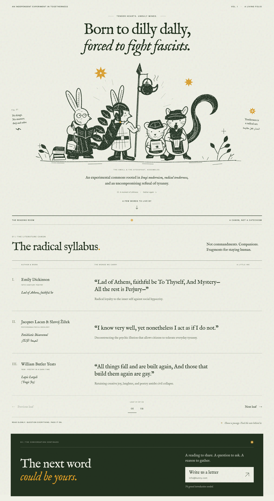

# BKF Radical Folio — Landing Page

> *"Born to dilly dally, forced to fight fascists."*  
> — Tender Hearts. Unruly Minds.



Official repository for the **BKF Radical Folio Landing Page**, faithfully imported from the original Figma file (`BKF Radical Folio Landing Page`).

---

## ✦ Overview & Sections

The landing page is designed as an illustrated broadsheet folio celebrating an independent experiment in togetherness, radical literature, and resistance:

### 1. Masthead & Hero Broadside
- **Masthead:** `AN INDEPENDENT EXPERIMENT IN TOGETHERNESS` / `VOL. I · A LIVING FOLIO`
- **Eyebrow:** `— TENDER HEARTS. UNRULY MINDS. —`
- **Headline:**
  - `Born to dilly dally,`
  - *`forced to fight fascists.`*
- **Marginalia:**
  - `Fig. 01: No kings. No masters. Only each other. ⚡`
  - `✹ Tenderness is a radical act. الحنان فعل مقاومة`
- **Central Linocut Tableau:** The four animal comrades (reading rabbit with wire spectacles and stacked texts, warrior rabbit bearing spear with steaming kettle, field mouse with starred folio, and newsboy sentry squirrel).
- **Caption:** `THE SMALL & THE STEADFAST, ASSEMBLED.` / *"An experimental commons rooted in Iraqi modernism, radical tenderness, and an uncompromising refusal of tyranny."*
- **Controls:** `|| A moment of stillness / Gather again ↺`
- **Navigation:** `A FEW WORDS TO LIVE BY ↓`

### 2. The Reading Room — 01 / The Literature Canon ("The radical syllabus.")
Broadsheet table presenting curated literary companions for staying human:
- **I. Emily Dickinson** (19TH-CENTURY POETRY):
  - *Lad of Athens, faithful be*
  - Quote: *"Lad of Athens, faithful be To Thyself, And Mystery— All the rest is Perjury—"*
  - Note: Radical loyalty to the inner self against social hypocrisy.
- **II. Jacques Lacan & Slavoj Žižek** (PSYCHOANALYSIS & IDEOLOGY):
  - *Fetishistic Disavowal* (تميمة الإنكار)
  - Quote: *"I know very well, yet nonetheless I act as if I do not."*
  - Note: Deconstructing the psychic illusion that allows citizens to tolerate everyday tyranny.
- **III. William Butler Yeats** (1936 · POETRY IN A DARK TIME):
  - *Lapis Lazuli (Tragic Joy)*
  - Quote: *"All things fall and are built again, And those that build them again are gay."*
  - Note: Retaining creative joy, laughter, and poetry amidst civil collapse.
- **Pagination:** `← Previous leaf` | `LEAF 01 OF 02` (`01` / `02`) | `Next leaf →`
- **Footer:** `READ SLOWLY. QUESTION EVERYTHING. PASS IT ON.` | `✹ Choose a passage. Find the note behind it.`

### 3. 02 / The Conversation Continues
- Forest green enclosure (`#233220`):
  - *"The next word could be yours."*
  - *"A reading to share. A question to ask. A reason to gather."*
  - Letter dispatch card to `info@bunny.com`.
  - *"No grand introduction needed."*

---

## ✦ Project Structure

```text
bkf-radical-folio/
├── assets/
│   └── images/
│       ├── characters_clean.png      # Trimmed high-res character tableau
│       ├── figma-full-design.png     # Full master design export (2244 × 4096)
│       └── favicon.svg               # Octagram star favicon
├── css/
│   └── style.css                     # Exact palette, serif typography & responsive layout
├── js/
│   └── main.js                       # Lightweight leaf pagination & UI controls
├── .github/
│   └── workflows/
│       └── deploy.yml                # Automated GitHub Pages deployment
├── BKF-Radical-Folio-Landing-Page.fig # Original Figma source archive
├── index.html                        # Semantic, self-contained landing page
├── package.json                      # Local server scripts
└── README.md
```

---

## ✦ Local Development

Open `index.html` directly in any web browser, or serve it with Python:

```bash
python3 -m http.server 8080
```

Visit [http://localhost:8080](http://localhost:8080).
